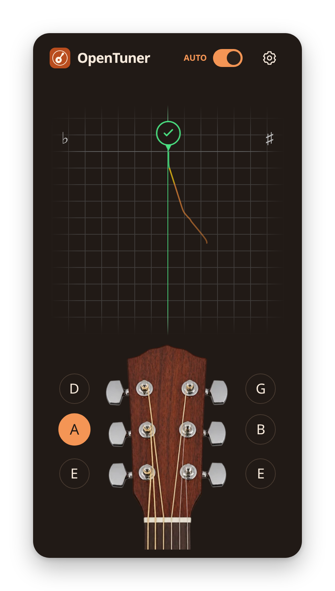

# OpenTuner

Just tune your guitar. Installable, offline, and entirely on your device.

<p align="center">
  
</p>

Automatic or manual tuning, six presets, and saved custom tunings.
System, light and dark themes. No account or audio uploads.

```sh
bun install
just dev      # localhost:5175
just check    # types, tests, production build
just build
just preview  # localhost:4175
```

Allow the microphone once, then just pluck a string. Listening starts
automatically. Tap a string to hear its reference note, or when it is far
out of tune. Offline use needs one complete online load first.
Microphone access requires HTTPS or localhost.

Releases use annotated `vX.Y.Z` tags. CI builds
`ghcr.io/saffronjam/opentuner:vX.Y.Z` and drafts release notes from the tag body.
Prepare releases with `/release-creator`; publish the draft when ready.
The `home` repository pins the image and deployment base for Argo CD.

MIT licensed. Pitch detection by [Pitchy](https://github.com/ianprime0509/pitchy).

Guitar reference recordings: [Meta Open Sound](https://github.com/facebookincubator/Meta-open-sound), CC0.
